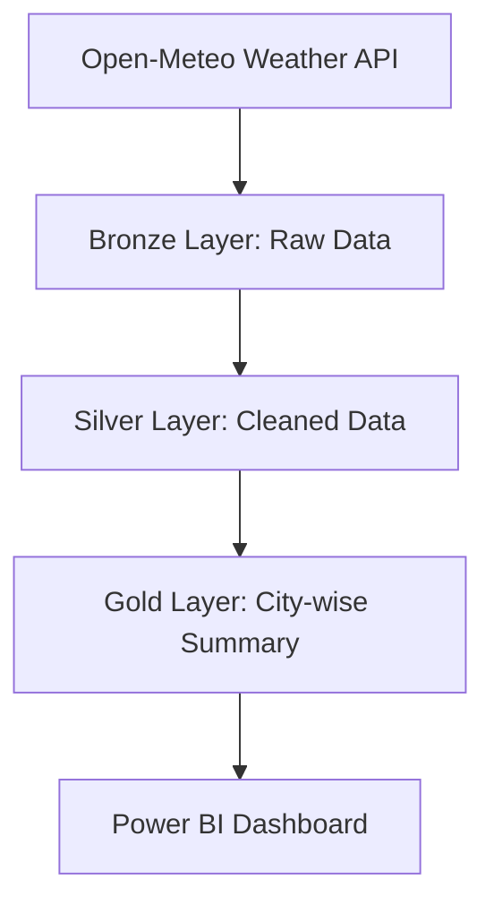

# Weather Data Pipeline — Pakistan

## 1. Project Overview

This project collects historical weather data for three cities in Pakistan — Lahore, Karachi, and Islamabad — using the Open-Meteo Weather API.

The data is processed using Azure Databricks, PySpark, and Delta Lake following the Medallion Architecture (Bronze, Silver, and Gold).

The final Gold layer provides city-wise weather summaries that can be used in a Power BI dashboard.

## 2. Problem Statement

Weather data is available through public APIs, but raw data needs to be stored, cleaned, validated, and transformed before it can be used for analysis.

The goal of this project is to build a data pipeline that collects hourly weather data for three Pakistani cities over 30 days, processes it through multiple layers, and prepares it for reporting and visualization.

## 3. Technologies Used

- Python
- Open-Meteo Historical Weather API
- Azure Databricks
- PySpark
- Delta Lake
- Power BI (planned for visualization)

## 4. Architecture

## 5. Data Sources

Weather data is collected for:

- Lahore
- Karachi
- Islamabad

Weather attributes include:

- Temperature (°C)
- Relative humidity (%)
- Wind speed (km/h)
- Timestamp

Source: [Open-Meteo Historical Weather API](https://open-meteo.com/en/docs/historical-weather-api)

## 6. Medallion Architecture

### Bronze Layer

Stores the raw weather data collected from the API.

Delta table: `weather_bronze`

### Silver Layer

Cleans and prepares the data by handling missing values, removing duplicate records, and converting columns to appropriate data types.

Delta table: `weather_silver`

### Gold Layer

Calculates city-wise average temperature, average humidity, average wind speed, and total record count.

Delta table: `weather_gold`

## 7. Data Quality Checks

The Silver layer was checked for:

- Missing values in required columns
- Duplicate records based on city and timestamp
- Minimum and maximum values for temperature, humidity, and wind speed

Initial validation results:

- Silver records: 2,160
- Missing values in checked columns: 0
- Duplicate records: 0
- Gold summary records: 3

## 8. Project Results

The pipeline successfully collected 2,160 hourly weather records for three cities over the selected 30-day period and stored the processed data in Delta tables.

The Gold layer contains one summary record per city.

## 9. Future Improvements

- Build an interactive Power BI dashboard.
- Schedule automatic pipeline execution.
- Add logging and error handling.
- Improve data quality validation.
- Publish the project and documentation on GitHub.

## 10. Author

Abdullah Tauseef